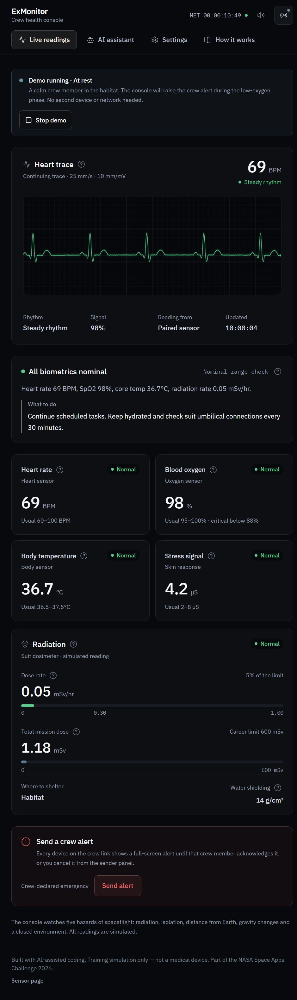
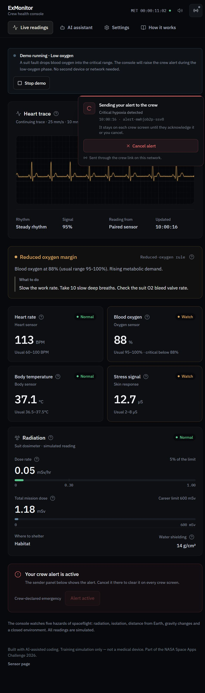
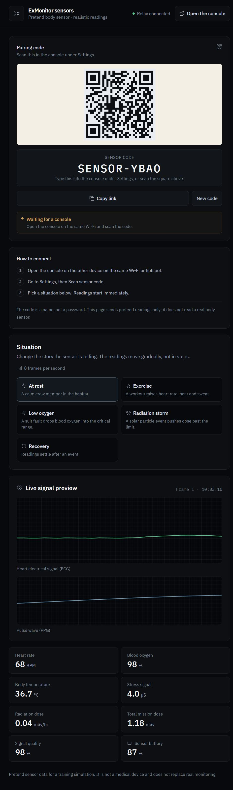

# ExMonitor

**A crew health console for a training simulation.** It shows live body readings, sends crew alerts across the
local network, and can answer questions with a language model that runs entirely in the browser.

> **Try it now:** open <https://exmonitor.extem.net/app/>, then press **Start Demo**. It cycles rest, exercise,
> low oxygen, radiation storm and recovery on one device, with no second phone, no camera and no network.



## How this was built (AI disclosure)

Most of this codebase and its copy were produced in a pair-programming loop between the human author and an AI
coding agent running in OpenCode. The author chose the direction, reviewed every change and ran the build and the
app. The assistant's answers at runtime are also AI output and can be wrong.

No images, audio or video in this repository were generated by AI. `favicon.svg`, `favicon-32x32.png` and
`apple-touch-icon.png` were drawn by hand for this project; every other visual is HTML and CSS. The full list of
dependencies, models, fonts and assets, with licences, is in [CREDITS.md](CREDITS.md).

## One-tap demo

Press **Start Demo** on the console (or on the first onboarding screen) and the console runs a simulated sensor
inside itself. It shows each situation for about eight seconds, raises the crew alert during low oxygen, and needs
no second device, camera or relay. Press **Stop demo** to end it. The full script is in
[DEMO_RUNBOOK.md](DEMO_RUNBOOK.md).


## Three pieces

| Piece | What it does |
| --- | --- |
| **Console** (`/`) | Heart trace, five vital cards, the written rules, the AI assistant and crew alerts. |
| **Sensor page** (`/sensors.html`) | Turns a phone or second screen into a pretend body sensor. It streams realistic readings eight times a second. |
| **Crew link** (`/relay`) | A small WebSocket relay inside the launcher, or a Durable Object on the hosted copy. It carries alerts, presence and sensor frames between devices. |

Two tabs in the same browser also reach each other through a local channel, so the relay is optional for a
quick demo.

## Requirements

- Node.js 18 or newer (the launcher and the relay use only built-in modules).
- A modern browser. Chrome or Edge is recommended.
- Optional, for the on-device assistant: WebGPU and an internet connection for the first model download.

## Run from the repository

```bash
npm install
npm run build     # builds the console and the sensor page into dist/
npm start         # serves dist/ and opens http://localhost:8080
```

`npm start` prints a second address for the local network. Open that address on a phone, add
`/sensors.html`, then scan the code shown there from **Settings → Scan sensor code** in the console.

For development with hot reload:

```bash
npm run relay     # relay only, port 8080
npm run dev       # Vite on port 5173, proxying /relay to 8080
```

## Use it on a phone

Open <https://exmonitor.extem.net/app/> on the phone. It is the same app, served with HTTPS, so the camera for
the QR code, notifications and "Add to Home screen" all work. The sensor page is at the same address plus
`sensors.html`. A phone and a computer on the same crew link see each other's alerts.

Phones usually run the written rules (No AI) well; the browser copy starts with No AI and you can pick a
model in Settings if the phone supports WebGPU. The AI weights download to each device on first use.

## Run a packaged download

The download page offers one ZIP per assistant and per operating system. Each ZIP contains exactly one start
file, so there is nothing to choose:

- Windows: double-click `Start ExMonitor.cmd`
- macOS: double-click `Start ExMonitor.command`
- Linux: run `./start-exmonitor.sh`

The launcher finds a free port, serves the app and the relay from one address, and opens the browser.
Nothing is installed into the system.

Each ZIP contains the latest built app plus `app/model-config.json`, which selects the assistant that was
chosen on the download page.

## The AI assistant

The assistant answers in two modes:

- **Doctor mode** (the default) attaches the medical prompt and the current readings to each question.
- **Assistant mode** is plain chat: no prompt and no readings.

Answers can come from either of two sources, chosen on the assistant screen:

- **On-device** — one of four choices:
  - **Phi-3.5 mini** — strongest answers, about 2.1 GB on first use.
  - **Llama 3.2 3B** — balanced, about 1.8 GB.
  - **Gemma 2 2B** — smallest, about 1.5 GB.
  - **No AI** — written action cards only, nothing to download.
- **Ollama** — a model already installed on this computer, such as the one pulled with `ollama pull phi3:3.8b-mini-4k-instruct-q8_0`.
  Set the server address (default `http://localhost:11434`) and the model name (default `phi3:3.8b-mini-4k-instruct-q8_0`) on the
  assistant screen. There is no download and no graphics-memory requirement.

On-device answers come from [WebLLM](https://github.com/mlc-ai/web-llm) running in a worker with WebGPU. The
model is downloaded once from Hugging Face, cached by the browser, and then works offline. Nothing is sent to a
server. Without WebGPU, or if a download fails, Doctor mode falls back to the written rules.

Ollama answers stay on this computer too. The browser has to be allowed to reach the server: start Ollama with
`OLLAMA_ORIGINS` set to this page's address, for example `OLLAMA_ORIGINS=* ollama serve`. This is only needed
when the page and Ollama are on different addresses, such as the hosted copy.

The chosen source and the chat mode are saved in `localStorage`. The model tier is saved the same way. A new
bundle carries a build stamp, so a freshly downloaded ZIP selects its own assistant once; a choice made later in
Settings is kept.

## Alerts

- **Sender** sees a compact panel with the alert status and one **Cancel alert** button. No full-screen
  overlay.
- **Other devices** show a full-screen alert until each one acknowledges it.
- **Acknowledge** clears the alert on that device and tells the sender who acknowledged.
- **Cancel** from the sender clears the alert on every device.
- Critical readings can also start an alert automatically; the sender can cancel it the same way.

System notifications are optional. Browsers only deliver them while the console is open or installed, and
only on `localhost` or HTTPS. The full-screen alert works everywhere while the page is open.

## Sensor page

Five situations change the story gradually rather than jumping between numbers:

- **At rest** — a calm crew member in the habitat.
- **Exercise** — heart rate, heat and sweat rise.
- **Low oxygen** — blood oxygen falls into the critical range and can start an alert.
- **Radiation storm** — dose rate climbs past the caution and critical lines.
- **Recovery** — readings settle after an event.

The page draws an ECG and a pulse wave from the generated signal and shows the same numbers the console
receives. Sensor codes are names, not passwords; keep the demo on a network you trust.

## Build the downloads

```bash
npm run build
npm run build:hosted   # the /app/ copy that phones open
npm run package:bundles
```

`scripts/package-bundles.mjs` writes one ZIP per assistant and system (twelve in total) to `bundles/` and
writes a `downloads.json` manifest with the size of each file. The ZIPs are not copied into the
site by default, because they are published on a GitHub release instead of being uploaded to Cloudflare with
every deploy. Options:

```bash
node scripts/package-bundles.mjs --models phi3:3.8b-mini-4k-instruct-q8_0,none --platforms windows --out bundles
```

Add `--site-copy` if you also want a local set inside `site/downloads/`.

## Download page and hosting

`site/` is a static landing page. It checks WebGPU, memory and processor cores in the browser, recommends a
copy, detects the visitor's system and links to `/downloads/<file>.zip`. The same page links to the hosted
console at `/app/`.

The hosted console is a second build of the app with `base` set to `/app/`; `scripts/build-hosted.mjs` builds
it and copies it into `site/app/`. The ZIP build stays at the folder root because the launcher serves it
there.

The Cloudflare Worker serves the landing page and the `/app/` console, so there is no storage bucket to set up
and no card is needed. `worker/index.js` sends `/downloads/<file>.zip` to the matching file on the repository's
`downloads` release, which keeps every deploy small and still allows a paused download to resume. The files
themselves are up to 4.3 MB each. `worker/relayRoom.js` is a Durable Object that carries the crew link for the
hosted copy. `/health` reports whether the relay is up and how many devices are connected.

Publishing is handled by `.github/workflows/release.yml` on every push to `main`:

1. Install, build the app and build the hosted copy.
2. Package the twelve ZIPs.
3. Publish them on the `downloads` release, replacing the previous files.
4. Deploy the Worker, the landing page and `/app/`.

To publish the page from this machine:

```bash
npx wrangler login
npm run build
npm run build:hosted
npm run package:bundles
npm run site:deploy
```

The ZIPs themselves are published by the workflow. Without the Cloudflare secrets the workflow still publishes
the ZIPs and skips the page deploy, so a push always leaves working downloads behind.

## Scripts

| Command | What it does |
| --- | --- |
| `npm run dev` | Vite dev server with the relay proxy. |
| `npm run build` | Type-check and build the console and the sensor page. |
| `npm run build:hosted` | Build the `/app/` copy for the hosted page and copy it into `site/app/`. |
| `npm start` | Serve the build and the relay from one address. |
| `npm run relay` | Relay only, for development. |
| `npm run package:bundles` | Create the twelve downloadable ZIPs and the manifest. |
| `npm run site:build` | Build everything the download page needs in one command. |
| `npm run site:dev` | Run the landing page and Worker locally with Wrangler. |
| `npm run site:deploy` | Deploy the download page and `/app/`; the ZIPs live on GitHub. |

## Screenshots

| Demo running | Crew alert raised | Sensor page |
| --- | --- | --- |
|  |  |  |

## How it fits together

- `src/` is one React app. A single telemetry provider owns the readings, the alert state, crew presence and the
  selected assistant, so every screen agrees.
- The console (`/`) and the sensor page (`/sensors.html`) are two entry points into the same code and the same
  relay client; the sensor page drives a signal generator instead of a real sensor.
- `server.js` is a zero-dependency launcher: it serves the built app and runs the WebSocket relay at `/relay` on
  one port, so a phone only needs one address.
- `worker/` serves the hosted copy and carries the same crew link as a Durable Object; `site/` is the download
  page and the `/app/` build.
- Everything that looks like a body sensor is simulated. No real sensor is read, and no reading leaves the device
  unless you use the crew link on your own network.

## Project layout

```
src/
  components/
    dashboard/    Heart trace, vital cards and radiation card
    ai/           AI assistant chat, model download, Ollama and rules fallback
    setup/        Settings page, sensor scanner
    onboarding/   First-run wizard
    emergency/    Receiver overlay and sender panel
    guide/        How it works page
    layout/       Header and section navigation
    ui/           Small shared pieces such as hover explanations
  context/        One provider for readings, alerts, presence and the model tier
  sensors/        The separate sensor page and its signal generator
  services/       Rules, WebLLM, relay client, notifications, profile, model catalog
server.js         Zero-dependency launcher, static server and relay
scripts/          Build helpers and bundle packaging
site/             Download landing page, hosted /app/ copy and the download list
worker/           Cloudflare Worker: landing page, ZIPs and the crew link room
```

## Limits

- The sensor page sends pretend readings. It is not a medical device and does not read a real body sensor.
- The ECG shape is generated from the simulated heart rate; it is not a measurement.
- AI answers can be wrong. The written action cards stay available on every copy.
- This is a training simulation. It does not replace real medical care or mission medical rules.

## References and data

- The Radiation card shows a 600 mSv career effective-dose limit from **NASA-STD-3001 Volume 1, Revision C**.
- No other NASA document numbers are cited anywhere in the app. The written rules use teaching values created
  for this simulation; they are not operational flight rules.
- Every third-party dependency, AI model, font, icon set and asset, with its licence, is listed in
  [CREDITS.md](CREDITS.md).

Built for the NASA Space Apps Challenge 2026. This is a training simulation, not a medical device, and it is not
affiliated with or endorsed by NASA.
